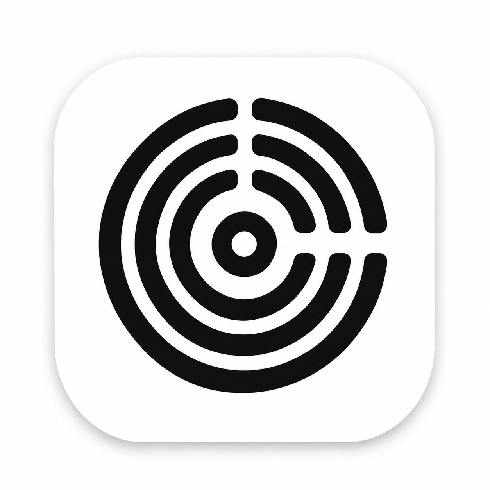

# Podlune

**Podlune** 是一个 **HarmonyOS NEXT 播客客户端**（ArkTS / ArkUI）。来源链条为 **AntennaPod → HomenaPod → Podlune**：上游是 Android 播客应用 [AntennaPod](https://github.com/AntennaPod/AntennaPod)（GNU GPL-3.0），[TomoeMami/HomenaPod](https://github.com/TomoeMami/HomenaPod) 是它的鸿蒙移植工程，**Podlune 是该移植工程的二次开发版本** —— 沿用其数据层与播放内核，重做界面与交互，并新增榜单、书签、自适应配色等能力。

[](https://www.gnu.org/licenses/gpl-3.0)
[](#技术栈)
[](#技术栈)
[](https://github.com/AntennaPod/AntennaPod)
[](https://github.com/TomoeMami/HomenaPod)

---

## 项目沿革

| 阶段 | 说明 |
|---|---|
| 上游语义 | [AntennaPod](https://github.com/AntennaPod/AntennaPod)（GPL-3.0）—— 功能语义、数据库表结构、播放 / 下载 / 队列的业务口径以其为蓝本 |
| 鸿蒙移植 | [TomoeMami/HomenaPod](https://github.com/TomoeMami/HomenaPod) —— 用 ArkTS/ArkUI 重新实现，源文件以 `// Port of: <上游路径>` 标注对应关系 |
| 本项目 | **Podlune** —— 在 HomenaPod 基础上重构界面与交互、新增功能，并将应用标识改为 **Podlune** / `com.podlune.app` |

> 应用名称、包名、图标与文案均已与 AntennaPod 区分，**不使用其名称或标识作为产品标识**；上游与移植工程仅作事实性署名。许可与商标说明见 [`podlune/NOTICE.md`](podlune/NOTICE.md)。

## 与 HomenaPod 的主要差异

| 域 | 变化 |
|---|---|
| 品牌 | 应用名 **Podlune**，`bundleName` **`com.podlune.app`**；跨包名的数据迁移见下文 |
| 视觉 | 单色 + 品牌紫的克制风格；播放器背景为「封面铺满 → `backgroundBlurStyle(BlurStyle.BACKGROUND_THICK)` 厚模糊 → 自上而下渐变压暗」三层，固定深色观感；图标统一为系统符号 |
| 播放器进度条 | `Slider`（`InSet`、`trackThickness(6)`、未播放 `#66FFFFFF`、已播放白色、滑块白色 12×12）；**两端时间固定占位**（`0:00` / `--:--`），**暂停状态下也能拖动** |
| 播放器工具条 | 时间点**书签**（点击标记 / 再点取消 / 长按查看列表）、带时间戳的**片段分享** |
| 首页 | 默认顺序调整为「**待播清单** → 播放列表 → 随机惊喜 → …」，仍可在「编辑区块」里自由拖动排序；待播清单卡片按钮随播放状态切换，并显示**动态剩余时间** |
| 队列 | 新增**插队规则**：当前播放项在队首时，新增项插到它下一行（连续新增则后加的更靠前）；播放置顶、拖拽排序、自然结束移除统一由 `position` 字段驱动 |
| 榜单 | 新增**榜单页**：中文播客榜（热门节目 / 热门播客 / 新锐节目 / 新锐播客）+ 苹果播客榜（热门节目 / 热门单集），每日 08:00 更新缓存 |
| 网络 | RSS 抓取改为**条件请求**（`ETag` / `Last-Modified`），304 时跳过下载与解析，明显改善境外源刷新耗时 |
| 数据库 | schema 升级到 **v4**：`Queue` 增加 `position` / `created_at` 与复合索引，支持稳定游标分页 |
| 媒体会话 | `AVSession` / 通知的包名改为**运行时读取**，改包名后无需改代码 |

## 功能特性

- **订阅**：RSS / Atom / iTunes 解析入库，iTunes Search 发现，私有订阅 Basic 认证，OPML 导入导出，标签、封面网格、排序与过滤、长按多选批量操作。
- **播放**：`AVPlayer` 流播放与本地播放，`AVSession` 锁屏 / 播控中心，`AUDIO_PLAYBACK` 后台长时任务，六档倍速（含每订阅倍速），快进快退秒数可配，跳片头片尾，音量适配，重复模式，睡眠定时（预设 / 自定义 / 渐弱 / 震动 / 章节结束），耳机与蓝牙中断处理。
- **队列**：持久化 + 内存引擎（串行化写入），插队与置顶见上，拖拽排序（浮层跟手、相邻让位、边缘自动滚动），排序菜单，锁定，多选，自动连播（仅自然结束才移除）。
- **发现**：首页推荐板块（含中文专区），在线搜索（播客 / 单集），**榜单页**（中文四榜 / 苹果两榜，点卡片直达单集详情）。
- **单集**：详情页（在线播放 / 加入队列 / 下载 / 收藏 / 标记），时间点书签，章节，文字稿（官方 RSS 提供时），复制单集链接。
- **下载与存储**：实时进度环，暂停 / 继续 / 取消 / 删除，失败分类与重试，自动下载策略，播放后自动删除，存储管理。
- **统计与历史**：收听统计（按月 / 按订阅）、播放历史、收藏。
- **后台**：`workScheduler` 定时刷新，新单集通知与动作策略。
- **外观**：深浅色主题、应用内语言切换、导航材质档位（关 / 柔 / 均衡 / 通透）、进度条配色开关、**沉浸光感**（卡片与按钮按压/常亮的 HDS 点光源材质）、**自定义字体**（导入 ttf/otf/ttc 全局生效）。
- **合规**：应用内「隐私政策与开源声明」页（开源许可 / 数据来源 / 隐私说明 / 权限用途）。

## 技术栈

| 层 | 选型 |
|---|---|
| 平台 | HarmonyOS NEXT，`compatibleSdkVersion` `5.0.2(14)`，`targetSdkVersion` `26.0.0` |
| 语言 / UI | ArkTS（严格模式）+ ArkUI 声明式（25 个页面） |
| 存储 | `relationalStore`（schema v4）+ `preferences` |
| 播放 | `AVPlayer` + `AVSession` + `AUDIO_PLAYBACK` 长时任务 |
| 网络 | `@ohos.net.http`，自研 `XmlReader` / `FeedParser`（Rss20 / Atom / iTunes / Media / PodcastIndex） |
| 图片 | 自研 `ImageCache`（磁盘缓存）+ `effectKit` 主色提取（进度条配色） |
| 后台 | `@ohos.resourceschedule.workScheduler` |
| 模块 | 单 `entry` 模块分层：`model` / `db` / `net` / `parser` / `player` / `download` / `services` / `pages` / `components` |

## 构建

需要 **DevEco Studio 5.x 及以上**（本项目在 DevEco Studio `26.0.0.821` + HarmonyOS SDK `26.0.0.105` 下构建）。

```bash
cd podlune
export DEVECO_SDK_HOME="/path/to/DevEco Studio/sdk"   # Windows: $env:DEVECO_SDK_HOME="..."

# 编译打包（debug）
hvigorw assembleHap --mode module -p product=default -p buildMode=debug --no-daemon
# 产物：entry/build/default/outputs/default/entry-default-signed.hap（已签名时）
```

**签名**：包名为 `com.podlune.app` 后，旧工程的调试证书不再适用。开发调试请在 DevEco Studio 的
「文件 → 项目结构… → 签名配置」勾选 **自动生成签名**（需登录华为开发者账号）；上架发布则需在
AppGallery Connect 申请**发布证书与 Release Profile** 后填入 `signingConfigs`。

**工程校验**（无需图形界面）：

```bash
bash podlune/scripts/check-project.sh    # 目录结构 / 导入路径 / 三语资源 / 页面注册
bash podlune/scripts/static-check.sh     # 静态类型检查（需 tsc）
```
## 数据来源

| 榜单 | 来源 |
|---|---|
| 中文播客榜（热门节目 / 热门播客 / 新锐节目 / 新锐播客） | [xyzrank.com](https://xyzrank.com) 公开接口 `/api/episodes`、`/api/podcasts`、`/api/new-episodes`、`/api/new-podcasts` |
| 苹果播客榜（热门节目 / 热门单集） | Apple 公开榜单 `rss.marketingtools.apple.com`，以及 `podcasts.apple.com/cn/charts` 页面解析（Apple 未提供公开的单集榜接口） |

榜单仅作为发现入口，缓存每日 08:00 更新一次；不存储、不分发第三方数据。

**从链接补全单集（默认开启）**：从第三方播客网页读取公开的标题、简介、封面与音频地址，仅用于补全你订阅的停更节目；不登录、不抓付费内容、不转存音频，请求失败时静默跳过，不影响正常刷新。

## 已知限制

| 项 | 说明 |
|---|---|
| 苹果「热门单集」 | 依赖 Apple 页面结构解析，其改版时该栏可能为空（失败保留旧缓存并提示重试） |
| 榜单节目 → 单集详情 | 需按「播客名 + 集标题」反查 RSS，首次点击约 1–3 秒；匹配失败会提示，不会跳到错误页面 |
| 跳过静音 | `AVPlayer` 无等价能力，对应设置以禁用态呈现 |
| 定时刷新 | `workScheduler` 最小间隔 2 小时 |

## 仓库结构

```
.
├── README.md                    ← 本文件
├── LICENSE                      ← GNU GPL-3.0 全文（分发/再发布必须保留）
├── .gitignore                   ← 排除构建产物、签名文件、截图与备份
├── docs/                        ← 架构、任务、数据 schema、UI 对齐与发版文档
├── podlune/          ← DevEco Studio 工程（直接打开此目录）
│   ├── AppScope/                ← 应用级配置（Podlune / com.podlune.app）
│   ├── entry/                   ← 唯一模块
│   │   └── src/main/
│   │       ├── ets/             ← model·db·net·parser·player·download·services·pages·components
│   │       └── resources/       ← 三语资源（base / zh_CN / en_US，共 633 条）
│   ├── scripts/                 ← 构建与校验脚本
│   └── NOTICE.md                ← 来源、许可与商标声明
└── .shots/                      ← 开发期真机截图与取证（不参与构建）
```

## 开源协议

- 本项目：**GNU GPL-3.0**（与上游 AntennaPod 一致），全文见 [`LICENSE`](LICENSE)。
- 上游与移植工程：AntennaPod（GPL-3.0）、HomenaPod（GPL-3.0）。
- 当前工程**未包含第三方原生代码**；若后续引入，须在 `NOTICE.md` 中保留其许可证与署名。

## 反馈

Bug 与建议请在本仓库提交 Issue，并尽量附上：设备型号、HarmonyOS 版本、复现步骤、相关日志（`hdc shell hilog -x`）与截图。
